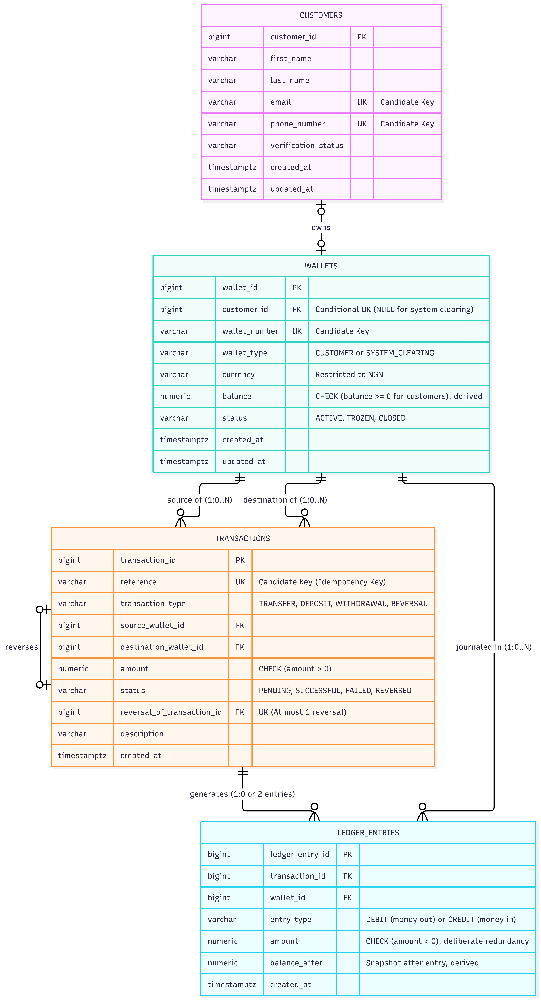
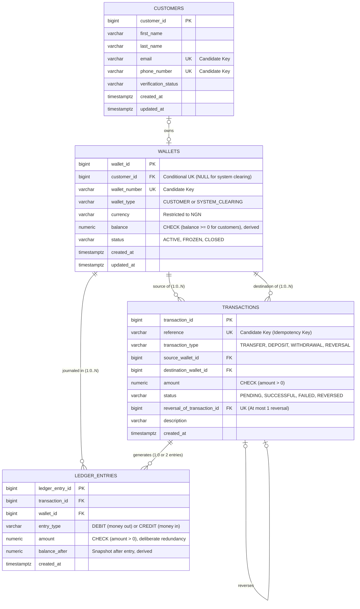

# KoraPay Wallet — Database Design

**Course:** MIT 8103 Advanced Database Systems  
**Student:** Sandra Aibangbee (Student ID: 2026/A/MIT/0301/301897710)  
**Portfolio:** 1 — Database Design and Modelling  
**Case study:** [Aibangbee_Sandra_2026_A_MIT_0301_301897710_P1_CaseStudy.md](./Aibangbee_Sandra_2026_A_MIT_0301_301897710_P1_CaseStudy.md)  
**Status:** The tables, keys and constraints in Sections 3 and 6 are implemented in [Aibangbee_Sandra_2026_A_MIT_0301_301897710_P1_02_CreateTables.sql](./Aibangbee_Sandra_2026_A_MIT_0301_301897710_P1_02_CreateTables.sql) and were tested (see the [README](./README.md#4-constraint-test-results-and-screenshots)). Posting logic, locking, idempotent retries, permissions, reversals and reconciliation (Sections 7–9) were **proposed** in Portfolio 1.

> [!NOTE]
> **Later portfolios.** Portfolio 3 implemented and tested parts of Sections 7–9: ascending `wallet_id` locking, a transfer function with idempotent retries, and reconciliation checks. Permissions (`SECURITY DEFINER` and revoked privileges), reversals and recording of failed attempts were not implemented.

---

## 1. Introduction and Design Goals

This document describes the relational design for **KoraPay Wallet**, a simulated Nigerian digital wallet platform.

The design aims for:
1. **Financial integrity:** money is tracked in a double-entry ledger. In this project, **`DEBIT` means money leaving a wallet** and **`CREDIT` means money entering a wallet**. This is a wallet-holder convention chosen for clarity, not the standard accounting definition.
2. **Concurrency safety:** two simultaneous requests must not overspend a wallet.
3. **Atomicity:** debiting the sender, crediting the recipient and writing the ledger entries succeed together or not at all.
4. **Duplicate prevention (idempotency):** a retried request with the same reference must not move money twice.
5. **Auditability:** every balance change has a matching ledger record.

The design uses four tables plus one **system clearing wallet** that acts as the other side of simulated deposits and withdrawals.

---

## 2. Core Tables and Their Purpose

| Table Name | Purpose |
| :--- | :--- |
| **`customers`** | Customer identity, contact details and simulated KYC status. |
| **`wallets`** | NGN wallets: one per customer, plus the single system clearing wallet. Holds the wallet status and a stored (cached) balance. |
| **`transactions`** | One row per request (transfer, deposit, withdrawal or reversal), with its unique reference, status and any reversal link. |
| **`ledger_entries`** | The financial journal. A successful movement is meant to write one debit and one credit, each with the wallet's balance afterwards (`balance_after`). |

---

## 3. Schema Specification: Tables, Columns, and Data Types

Names use PostgreSQL `snake_case`. All money columns use `NUMERIC(18,2)` to avoid floating-point rounding errors.

### 3.1 Table: `customers`
Stores individual and small-business customer profiles.

| Column Name | PostgreSQL Data Type | Constraints | Description |
| :--- | :--- | :--- | :--- |
| `customer_id` | `BIGSERIAL` | `PRIMARY KEY` | Generated identifier for each customer. |
| `first_name` | `VARCHAR(50)` | `NOT NULL` | Customer's first name. |
| `last_name` | `VARCHAR(50)` | `NOT NULL` | Customer's last name or registered business name. |
| `email` | `VARCHAR(255)` | `NOT NULL, UNIQUE` | Email address (candidate key). |
| `phone_number` | `VARCHAR(20)` | `NOT NULL, UNIQUE` | Phone number (candidate key). |
| `verification_status` | `VARCHAR(20)` | `NOT NULL, DEFAULT 'PENDING'` | Simulated KYC status: `'PENDING'`, `'VERIFIED'`, `'SUSPENDED'`. |
| `created_at` | `TIMESTAMPTZ` | `NOT NULL, DEFAULT CURRENT_TIMESTAMP` | When the profile was created. |
| `updated_at` | `TIMESTAMPTZ` | `NOT NULL, DEFAULT CURRENT_TIMESTAMP` | When the profile was last changed. |

*Candidate keys:* `{customer_id}` (primary key), `{email}`, `{phone_number}`.

---

### 3.2 Table: `wallets`
Stores NGN wallets. Each customer wallet belongs to one customer. The single system clearing wallet has no owner and is the other side of simulated deposits and withdrawals.

| Column Name | PostgreSQL Data Type | Constraints | Description |
| :--- | :--- | :--- | :--- |
| `wallet_id` | `BIGSERIAL` | `PRIMARY KEY` | Generated identifier for each wallet. |
| `customer_id` | `BIGINT` | `NULL, UNIQUE, REFERENCES customers(customer_id)` | Owner. Required for customer wallets, `NULL` for the clearing wallet. Unique, so a customer has at most one wallet. |
| `wallet_number` | `VARCHAR(20)` | `NOT NULL, UNIQUE` | Public wallet number, e.g. a 10-digit NUBAN-style number (candidate key). |
| `wallet_type` | `VARCHAR(20)` | `NOT NULL, DEFAULT 'CUSTOMER'` | `'CUSTOMER'` or `'SYSTEM_CLEARING'`. |
| `currency` | `VARCHAR(3)` | `NOT NULL, DEFAULT 'NGN'` | ISO currency code; only `'NGN'` is allowed. |
| `balance` | `NUMERIC(18,2)` | `NOT NULL, DEFAULT 0.00` | Current balance. A **stored derived value**, kept so a balance can be read without summing the ledger. |
| `status` | `VARCHAR(20)` | `NOT NULL, DEFAULT 'ACTIVE'` | `'ACTIVE'`, `'FROZEN'` or `'CLOSED'`. |
| `created_at` | `TIMESTAMPTZ` | `NOT NULL, DEFAULT CURRENT_TIMESTAMP` | When the wallet was opened. |
| `updated_at` | `TIMESTAMPTZ` | `NOT NULL, DEFAULT CURRENT_TIMESTAMP` | When the balance or status last changed. |

*Candidate keys:* `{wallet_id}` (primary key), `{wallet_number}`.  
*Why `customer_id` is not a candidate key:* it is `NULL` for the clearing wallet, and a candidate key cannot contain nulls. It is unique only among customer wallets (a **conditional unique identifier**).

*Implemented constraints on `wallets`:*
- **One wallet per customer:** `UNIQUE (customer_id)`.
- **Owner rule:** customer wallets need an owner; the clearing wallet must not have one.
  ```sql
  CHECK (
      (wallet_type = 'CUSTOMER' AND customer_id IS NOT NULL) OR
      (wallet_type = 'SYSTEM_CLEARING' AND customer_id IS NULL)
  )
  ```
- **One clearing wallet only:** a partial unique index.
  ```sql
  CREATE UNIQUE INDEX uq_single_system_clearing_wallet 
  ON wallets (wallet_type) 
  WHERE wallet_type = 'SYSTEM_CLEARING';
  ```
- **No negative customer balances:** the clearing wallet may go negative, because it records money paid into the simulated system.
  ```sql
  CHECK (
      (wallet_type = 'CUSTOMER' AND balance >= 0) OR 
      (wallet_type = 'SYSTEM_CLEARING')
  )
  ```

---

### 3.3 Table: `transactions`
One row per request. It records the wallets involved, the request reference, the status and any reversal link.

| Column Name | PostgreSQL Data Type | Constraints | Description |
| :--- | :--- | :--- | :--- |
| `transaction_id` | `BIGSERIAL` | `PRIMARY KEY` | Generated identifier for each transaction. |
| `reference` | `VARCHAR(64)` | `NOT NULL, UNIQUE` | Client-supplied request reference (idempotency key; candidate key). |
| `transaction_type` | `VARCHAR(20)` | `NOT NULL` | `'TRANSFER'`, `'DEPOSIT'`, `'WITHDRAWAL'` or `'REVERSAL'`. |
| `source_wallet_id` | `BIGINT` | `NOT NULL, REFERENCES wallets(wallet_id)` | Wallet debited. For deposits, the clearing wallet. |
| `destination_wallet_id` | `BIGINT` | `NOT NULL, REFERENCES wallets(wallet_id)` | Wallet credited. For withdrawals, the clearing wallet. |
| `amount` | `NUMERIC(18,2)` | `NOT NULL` | Transaction amount; `CHECK (amount > 0)`. |
| `status` | `VARCHAR(20)` | `NOT NULL, DEFAULT 'PENDING'` | `'PENDING'`, `'SUCCESSFUL'`, `'FAILED'` or `'REVERSED'`. |
| `reversal_of_transaction_id` | `BIGINT` | `NULL, REFERENCES transactions(transaction_id)` | For a reversal, the original transaction. |
| `description` | `VARCHAR(255)` | `NULL` | Optional note or failure reason. |
| `created_at` | `TIMESTAMPTZ` | `NOT NULL, DEFAULT CURRENT_TIMESTAMP` | When the request was created. |

*Candidate keys:* `{transaction_id}` (primary key), `{reference}`.

*Implemented constraints on `transactions`:*
- **Different wallets:** `CHECK (source_wallet_id <> destination_wallet_id)`.
- **Positive amount:** `CHECK (amount > 0)`.
- **Reversal link:** required for a `'REVERSAL'`, not allowed otherwise, and a transaction cannot reverse itself.
- **At most one reversal per transaction:** a partial unique index.
  ```sql
  CREATE UNIQUE INDEX uq_single_reversal_per_transaction 
  ON transactions (reversal_of_transaction_id) 
  WHERE reversal_of_transaction_id IS NOT NULL;
  ```

*Failed requests:* if a transfer fails (for example, insufficient funds) and is rolled back, the rollback also removes its `'PENDING'` row. No `'FAILED'` row is kept unless a separate failure-recording step is added, which is proposed only.

---

### 3.4 Table: `ledger_entries`
The double-entry journal. The design intends every balance change to have matching ledger entries. The schema alone does not enforce this; it depends on the posting logic in Section 8.

| Column Name | PostgreSQL Data Type | Constraints | Description |
| :--- | :--- | :--- | :--- |
| `ledger_entry_id` | `BIGSERIAL` | `PRIMARY KEY` | Generated identifier for each journal line. |
| `transaction_id` | `BIGINT` | `NOT NULL, REFERENCES transactions(transaction_id)` | Parent transaction. |
| `wallet_id` | `BIGINT` | `NOT NULL, REFERENCES wallets(wallet_id)` | Wallet affected. |
| `entry_type` | `VARCHAR(6)` | `NOT NULL` | `'DEBIT'` (money out) or `'CREDIT'` (money in). |
| `amount` | `NUMERIC(18,2)` | `NOT NULL` | Amount moved; `CHECK (amount > 0)`. |
| `balance_after` | `NUMERIC(18,2)` | `NOT NULL` | The wallet's balance immediately after this entry (**stored derived value**). |
| `created_at` | `TIMESTAMPTZ` | `NOT NULL, DEFAULT CURRENT_TIMESTAMP` | When the entry was written. |

*Candidate keys:* `{ledger_entry_id}` (primary key) and `{transaction_id, entry_type}` (enforced by `UNIQUE (transaction_id, entry_type)`: at most one DEBIT and one CREDIT per transaction).

*Deliberate redundancy:* both entries of a transaction carry the transaction's amount, so `transaction_id -> amount`. Because `transaction_id` is only part of the key `{transaction_id, entry_type}`, this is a partial dependency: a deliberate departure from 2NF, and therefore from 3NF (see Section 10.3 and the [normalisation report](./Aibangbee_Sandra_2026_A_MIT_0301_301897710_P1_Normalisation.md#44-table-ledger_entries)). Keeping these amounts equal depends on the posting logic in Section 8, not on the schema.

---

## 4. Entity-Relationship (ER) Diagram





---

## 5. Relationships and Cardinalities

1. **`customers` to `wallets` (zero-or-one to zero-or-one):**
   - Every customer wallet has exactly one owner (`customer_id IS NOT NULL`).
   - The clearing wallet has no owner (`customer_id IS NULL`).
   - A customer has at most one wallet (`UNIQUE (customer_id)`).
   - *Proposed:* registration creates the customer and their wallet in one transaction, so a registered customer always has a wallet. This was not implemented as a routine.

2. **`wallets` to `transactions` (one-to-many):** a wallet can be the source or the destination of any number of transactions.

3. **`transactions` to `ledger_entries` (one to zero or two):**
   - **Pending or failed:** no ledger entries, because no money moved.
   - **Successful:** two entries of equal amount:
     - transfer: DEBIT on the sender, CREDIT on the recipient;
     - deposit: DEBIT on the clearing wallet, CREDIT on the customer;
     - withdrawal: DEBIT on the customer, CREDIT on the clearing wallet.
   - **Reversed:** the original keeps its two entries. The reversal transaction adds two new entries in the opposite direction, giving four in total.

4. **`wallets` to `ledger_entries` (one-to-many):** each wallet builds up a history of debits and credits.

5. **`transactions` to `transactions` (reversal, zero-or-one to zero-or-one):**
   - A normal transaction has no reversal link (`reversal_of_transaction_id IS NULL`).
   - A transaction can be reversed at most once (partial unique index on `reversal_of_transaction_id`).

---

## 6. Business Rules and How They Are Enforced

Each business rule from the [case study](./Aibangbee_Sandra_2026_A_MIT_0301_301897710_P1_CaseStudy.md), with its enforcement and whether that is implemented in the schema or proposed.

| Business rule | Enforcement | Status |
| :--- | :--- | :--- |
| **Each customer has one NGN wallet.** | `UNIQUE (customer_id)` and `CHECK (currency = 'NGN')` on `wallets`. Creating the customer and wallet together is proposed. | Constraints implemented; registration routine proposed |
| **One clearing wallet, with no owner.** | Owner `CHECK` on `wallets` plus partial unique index `uq_single_system_clearing_wallet`. | Implemented |
| **Amounts must be greater than zero.** | `CHECK (amount > 0)` on `transactions` and `ledger_entries`. | Implemented |
| **Customer balances must not go negative.** | `CHECK ((wallet_type = 'CUSTOMER' AND balance >= 0) OR wallet_type = 'SYSTEM_CLEARING')`. | Implemented |
| **No transfer to the same wallet.** | `CHECK (source_wallet_id <> destination_wallet_id)`. | Implemented |
| **Each request has a unique reference.** | `UNIQUE (reference)` on `transactions`. | Implemented |
| **At most one reversal per transaction.** | Partial unique index `uq_single_reversal_per_transaction`. | Implemented |
| **Pending/failed transactions have no ledger entries; successful ones have two.** | `UNIQUE (transaction_id, entry_type)` allows at most two. Writing exactly two needs posting logic. | Partly implemented; posting logic proposed |
| **Reversals keep the original records and add compensating entries.** | Reversal logic (Section 7.4). | Proposed |
| **Ledger entries cannot be changed; balances match the ledger.** | Revoke direct writes from application roles; reconciliation query (Section 8). | Proposed |

---

## 7. Transactions, Locking and Error Handling (Proposed)

Constraints check individual rows. Moving money safely across several rows also needs **database transactions** (`BEGIN ... COMMIT / ROLLBACK`) and locking.

### 7.1 Concurrency Risk: Overspending from Stale Balance Reads
- **The risk:** PostgreSQL never allows dirty reads. The real risk is two transfers reading the same balance before either updates it:
  - Customer A has ₦10,000.
  - Two ₦8,000 transfers arrive at the same time on separate connections.
  - Both read ₦10,000, both decide ₦10,000 ≥ ₦8,000, and both continue.
  - Without row locks, either both succeed (overspending) or one update overwrites the other (a lost update).
- **Proposed lock order:**
  1. Start the transaction (`BEGIN`).
  2. Lock **both** wallets in **ascending `wallet_id` order**:
     ```sql
     -- Lock both wallets in strict numeric order to reduce wallet-lock deadlocks
     SELECT wallet_id, balance, status 
     FROM wallets 
     WHERE wallet_id IN ($source_id, $destination_id) 
     ORDER BY wallet_id ASC 
     FOR UPDATE;
     ```
  3. If one transfer goes from Wallet 1 to Wallet 2 while another goes from Wallet 2 to Wallet 1, both try to lock Wallet 1 first. One gets the lock and the other waits, so they cannot deadlock on these two rows.
  4. **Other deadlocks:** other locks (for example on the `transactions.reference` unique index) can still deadlock. PostgreSQL then aborts one transaction with `40P01` (`deadlock_detected`), and the application should retry with the **same reference**.
  5. With both rows locked, check that:
     - both wallets are `'ACTIVE'`;
     - the source wallet has enough money (`balance >= amount`).
  6. If a check fails, `ROLLBACK` so nothing changes.

### 7.2 All-or-Nothing Transfers and Errors
- **Atomicity:** the debit, the credit, the transaction row and both ledger entries commit together or not at all.
- **Aborted transactions:** after any error inside a transaction block, PostgreSQL rejects further statements (`current transaction is aborted, commands ignored until end of transaction block`) until the client sends `ROLLBACK`.
- **No record of rejected requests:** a `ROLLBACK` also removes the `'PENDING'` row, so nothing is left from the attempt. Keeping a `'FAILED'` record would need a separate transaction or audit table (proposed only).
- **Connection lost during `COMMIT`:** the client cannot tell whether the commit happened. It must retry with the **same reference**; the server then finds the existing record instead of moving money again.

### 7.3 Idempotency and Duplicate Requests
1. **Claim the reference first:** insert the `transactions` row as `'PENDING'` before moving money.
2. **Handle a duplicate without an aborted transaction.** A `UNIQUE (reference)` violation aborts the transaction block. To avoid that, either:
   - use `INSERT ... ON CONFLICT (reference) DO NOTHING`, or
   - catch the error, `ROLLBACK`, and look up the existing row in a new transaction.
3. **Compare the request with the stored row:** check `source_wallet_id`, `destination_wallet_id` and `amount`. The `transactions` table has no currency column, so currency is checked through the two wallets (both must be `'NGN'`).
   - **Same request:** return the original result without debiting again.
   - **Different request with the same reference:** reject it with an error (for example `Idempotency Conflict: Parameter Mismatch`).

### 7.4 Reversals
1. **Check the original:** it exists, is `'SUCCESSFUL'`, and is a `'TRANSFER'`, `'DEPOSIT'` or `'WITHDRAWAL'` (a reversal cannot itself be reversed).
2. **Check it has not been reversed already** (the unique index on `reversal_of_transaction_id`).
3. **Swap the wallets, same amount:** the original recipient is debited and the original sender credited, for the full original amount.
4. **Lock and check:** lock both wallets in `wallet_id` order; the wallet being debited must be `'ACTIVE'` with `balance >= amount`.
5. **Add, never edit:** insert a new `'REVERSAL'` transaction and two new ledger entries (DEBIT on the original recipient, CREDIT on the original sender). The original rows are not changed or deleted.
6. **Mark the original** as `'REVERSED'`.

---

## 8. Keeping Balances and the Ledger Consistent (Proposed)

The design stores each balance in two forms:
1. **Cached balance (`wallets.balance`):** a stored value that can be read and locked quickly.
2. **Ledger history (`ledger_entries`):** every debit and credit ever written.

### What foreign keys cannot do
Foreign keys make sure linked IDs exist. They cannot:
- require exactly two ledger entries per transaction;
- require one DEBIT and one CREDIT;
- require the two amounts to be equal;
- keep `wallets.balance` equal to the ledger total.

### Proposed controls
1. **One posting routine:** all balance updates and ledger writes go through one routine (for example a PL/pgSQL function `post_ledger_movement(...)`). It:
   - locks both wallets in `wallet_id` order;
   - checks wallet status and available balance;
   - updates both `wallets.balance` values;
   - inserts the matching DEBIT and CREDIT with their `balance_after` values;
   - marks the transaction `'SUCCESSFUL'`.
2. **Least-privilege permissions:**
   - The application role can `SELECT` balances and history.
   - Direct `INSERT`, `UPDATE` and `DELETE` on `ledger_entries` and direct `UPDATE` on `wallets.balance` are revoked from the application role.
   - Writes happen only through the posting function, defined as `SECURITY DEFINER`.
3. **Reconciliation query:** lists any wallet whose cached balance differs from its ledger total.
   ```sql
   -- Proposed Balance Reconciliation Audit Query
   SELECT 
       w.wallet_id,
       w.wallet_number,
       w.balance AS cached_balance,
       COALESCE(SUM(
           CASE 
               WHEN le.entry_type = 'CREDIT' THEN le.amount 
               WHEN le.entry_type = 'DEBIT'  THEN -le.amount 
               ELSE 0 
           END
       ), 0.00) AS ledger_sum,
       w.balance - COALESCE(SUM(
           CASE 
               WHEN le.entry_type = 'CREDIT' THEN le.amount 
               WHEN le.entry_type = 'DEBIT'  THEN -le.amount 
               ELSE 0 
           END
       ), 0.00) AS discrepancy
   FROM wallets w
   LEFT JOIN ledger_entries le ON w.wallet_id = le.wallet_id
   GROUP BY w.wallet_id, w.wallet_number, w.balance
   HAVING w.balance <> COALESCE(SUM(
       CASE 
           WHEN le.entry_type = 'CREDIT' THEN le.amount 
           WHEN le.entry_type = 'DEBIT'  THEN -le.amount 
           ELSE 0 
       END
   ), 0.00);
   ```

---

## 9. Duplicate Request Prevention (Proposed Protocol)

Weak mobile connections can cause a user to tap "Transfer" twice, or a client library to retry a request that timed out.

1. **The client creates a key:** each new transfer gets a unique key (for example a UUID v4), sent as `reference`.
2. **The reference is claimed first:** the transfer transaction starts by inserting the `'PENDING'` row (Section 7.3).
3. **A repeated reference:**
   - triggers `UNIQUE (reference)`;
   - is handled without querying inside an aborted transaction (`ON CONFLICT DO NOTHING`, or a fresh lookup after `ROLLBACK`);
   - is compared with the stored row on `source_wallet_id`, `destination_wallet_id` and `amount` (currency via the wallets, as in Section 7.3):
     - **match:** return the existing status (`SUCCESSFUL`, `PENDING`, or `FAILED` if failures are recorded) without debiting again;
     - **mismatch:** reject (for example `422 Unprocessable Entity - Idempotency Key Reused with Different Payload`).

---

## 10. Normalisation Summary

The full step-by-step analysis is in the [normalisation report](./Aibangbee_Sandra_2026_A_MIT_0301_301897710_P1_Normalisation.md). Normal forms must be checked against **every candidate key**, not just the primary key.

### Candidate keys
A candidate key is a minimal set of non-null attributes that identifies each row.
- **`customers`:** `{customer_id}`, `{email}`, `{phone_number}`.
- **`wallets`:** `{wallet_id}`, `{wallet_number}`. (`customer_id` is not a candidate key because it is `NULL` for the clearing wallet.)
- **`transactions`:** `{transaction_id}`, `{reference}`.
- **`ledger_entries`:** `{ledger_entry_id}` and the composite key `{transaction_id, entry_type}`.

---

### 10.1 First Normal Form (1NF)
**Rule:** every attribute holds a single (atomic) value, with no repeating groups, and each row can be identified by a key.

**In KoraPay Wallet:**
- All columns hold single values. Ledger lines are separate rows in `ledger_entries`, not a list stored inside `transactions`.
- Splitting names into `first_name` and `last_name` is a design choice for sorting and display. It is **not** required by 1NF; a full name is also an atomic value.
- Every table has a primary key.

---

### 10.2 Second Normal Form (2NF)
**Rule:** in 1NF, and no non-key attribute depends on only part of a composite candidate key.

**In KoraPay Wallet:**
- `customers`, `wallets` and `transactions` have only single-column candidate keys, so a partial dependency cannot occur. They are in 2NF.
- `ledger_entries` has the composite key `{transaction_id, entry_type}`, and `amount` depends on `transaction_id` alone. This partial dependency is a **deliberate** departure from 2NF (Section 10.3).

---

### 10.3 Third Normal Form (3NF) and Deliberate Redundancy
**Rule:** in 2NF, and for every non-trivial dependency $X \rightarrow A$, either $X$ is a superkey or $A$ is part of a candidate key.

**In KoraPay Wallet:**
- **`customers`, `wallets` and `transactions` are in 3NF:** every dependency comes from a candidate key.
- **Why customers and wallets are separate tables:** each customer has at most one wallet, so `customer_id` and `wallet_id` determine each other for customer wallets. Separating them is therefore not strictly required by 3NF. They are kept separate because:
  1. **They are different things:** customers are people or businesses; wallets are accounts.
  2. **The clearing wallet has no owner:** a merged table would need dummy customer details or `NULL`s in required columns (`first_name`, `last_name`, `email`, `phone_number`).
  3. **Future change:** separate tables would allow, for example, more than one wallet per customer later.
- **`ledger_entries` is deliberately denormalised:** `transaction_id -> amount`, `transaction_id` is not a superkey, and `amount` is not part of a candidate key. Keeping `amount` on each entry lets statements and audits use `ledger_entries` without joining `transactions`. The equal-amount rule depends on the posting logic (Section 8), not on the schema.

---

### 10.4 Stored Derived and Repeated Values (Controlled Denormalisation)
Normalisation discourages storing values that can be calculated from other data. This schema deliberately stores **two derived values and one repeated value**:
1. **`wallets.balance`** (derived): total credits minus total debits for the wallet.
2. **`ledger_entries.balance_after`** (derived): the wallet's balance just after that entry.
3. **`ledger_entries.amount`** (repeated): a copy of `transactions.amount` (Section 10.3).

**Why:** summing a large ledger on every payment would be slow and would increase contention. A stored balance can be read and locked (`SELECT ... FOR UPDATE`) directly, and `balance_after` shows the balance at each point in history. The cost is that these copies can drift from the ledger, so the posting logic and the reconciliation query (Section 8) are needed to keep them aligned.

---

## 11. Glossary

- **ACID:** the four guarantees of a database transaction:
  - **Atomicity:** all of its changes happen, or none do.
  - **Consistency:** it moves the data from one valid state to another, respecting all constraints.
  - **Isolation:** concurrent transactions do not see each other's unfinished work (how strictly depends on the isolation level).
  - **Durability:** once committed, changes survive a crash.
- **Aborted transaction:** after an error inside a PostgreSQL transaction block, further statements are rejected until `ROLLBACK`.
- **Candidate key:** a minimal set of non-null columns that identifies each row. One is chosen as the primary key; the others are alternate keys.
- **Compensating entry:** a new ledger entry that cancels an earlier one without editing or deleting it.
- **Conditional unique identifier:** a column that is unique where it has a value but is `NULL` for some rows (here, `wallets.customer_id`), so it is not a candidate key.
- **Controlled posting logic:** one routine that performs the balance check, both balance updates and both ledger entries in a single transaction.
- **DEBIT and CREDIT (this project):** DEBIT = money out of a wallet; CREDIT = money into a wallet. Standard accounting uses these words differently.
- **Idempotency:** running the same request several times has the same effect as running it once.
- **Lost update:** two transactions read the same value and one overwrites the other's change.
- **Pessimistic locking (`SELECT ... FOR UPDATE`):** locks the selected rows until the transaction ends, so competing transactions must wait.
- **Lock ordering:** always locking wallets in ascending ID order, so two transfers cannot wait on each other in a cycle. Retries are still needed for other kinds of deadlock.
- **System clearing wallet:** the one wallet with no owner. It is the other side of simulated deposits and withdrawals, so every movement has both a debit and a credit.
- **Surrogate key:** a generated identifier (for example an auto-increment number) with no business meaning.
