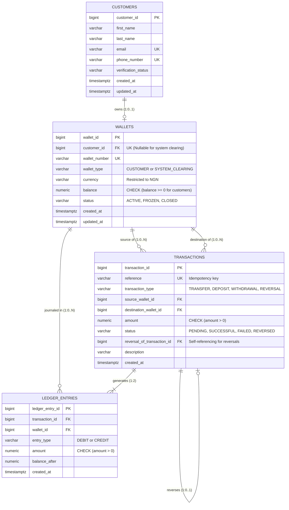

# KoraPay Wallet — Proposed Database Design

**Course:** MIT 8103 Advanced Database Systems  
**Portfolio Milestone:** 1 — Database Design and Modelling  
**Case Study Reference:** [case-study.md](./case-study.md)  
**Status:** Design Proposal (No SQL execution or table creation yet)

---

## 1. Introduction and Design Objectives

This document presents the relational database design for **KoraPay Wallet**, a simulated Nigerian digital wallet platform engineered for academic study. 

The primary goals of this database design are:
1. **Financial Integrity:** Enforce exact money tracking using the double-entry bookkeeping principle.
2. **Concurrency Safety:** Prevent overspending when two transfers are attempted at the same time.
3. **Atomicity:** Ensure that debiting the sender and crediting the recipient happen together, or not at all.
4. **Duplicate Prevention (Idempotency):** Guarantee that repeated network requests cannot trigger repeated fund transfers.
5. **Auditability:** Retain an immutable history of all balance changes and financial transactions.

To keep the system manageable for a student portfolio while upholding professional engineering standards, the design centers on four core relational tables and incorporates a **System Clearing Account** to handle simulated wallet deposits and withdrawals.

---

## 2. Core Tables and Their Purpose

The database schema consists of four core tables:

| Table Name | Purpose |
| :--- | :--- |
| **`customers`** | Stores customer identity, contact information, and simulated verification status. |
| **`wallets`** | Stores digital wallets denominated in Nigerian Naira (`NGN`), including user wallets and a dedicated system clearing account. Tracks real-time balances and operational status. |
| **`transactions`** | Records high-level business transaction requests (transfers, deposits, withdrawals, reversals), request references for duplicate prevention, and execution status. |
| **`ledger_entries`** | The immutable, double-entry financial journal. Every money movement generates balanced debit and credit entries that serve as the single source of financial truth. |

---

## 3. Schema Specification: Tables, Columns, and Data Types

All table and column names follow PostgreSQL conventions (`snake_case`). All monetary values strictly use `NUMERIC(18,2)` to avoid floating-point rounding errors.

### 3.1 Table: `customers`
Stores individual and small-business customer profiles.

| Column Name | PostgreSQL Data Type | Constraints | Description |
| :--- | :--- | :--- | :--- |
| `customer_id` | `BIGSERIAL` | `PRIMARY KEY` | Unique surrogate identifier for each customer. |
| `first_name` | `VARCHAR(50)` | `NOT NULL` | Customer's first name. |
| `last_name` | `VARCHAR(50)` | `NOT NULL` | Customer's last name or registered business name. |
| `email` | `VARCHAR(255)` | `NOT NULL, UNIQUE` | Customer's email address (used for login and notifications). |
| `phone_number` | `VARCHAR(20)` | `NOT NULL, UNIQUE` | Unique phone number in standard international/local format. |
| `verification_status` | `VARCHAR(20)` | `NOT NULL, DEFAULT 'PENDING'` | Simulated KYC status: `'PENDING'`, `'VERIFIED'`, `'SUSPENDED'`. |
| `created_at` | `TIMESTAMPTZ` | `NOT NULL, DEFAULT CURRENT_TIMESTAMP` | Timestamp when the customer profile was created. |
| `updated_at` | `TIMESTAMPTZ` | `NOT NULL, DEFAULT CURRENT_TIMESTAMP` | Timestamp when the customer profile was last modified. |

---

### 3.2 Table: `wallets`
Stores the digital wallets. Each registered customer owns exactly one `NGN` wallet. A special system record (`wallet_type = 'SYSTEM_CLEARING'`) acts as the clearing counterparty for simulated deposits and withdrawals.

| Column Name | PostgreSQL Data Type | Constraints | Description |
| :--- | :--- | :--- | :--- |
| `wallet_id` | `BIGSERIAL` | `PRIMARY KEY` | Unique surrogate identifier for each wallet. |
| `customer_id` | `BIGINT` | `NULL, UNIQUE, REFERENCES customers(customer_id)` | Foreign key linking to the customer. Nullable solely for system clearing accounts. Unique ensures 1 customer = 1 wallet. |
| `wallet_number` | `VARCHAR(20)` | `NOT NULL, UNIQUE` | Customer-facing account number (e.g., 10-digit NUBAN-style number). |
| `wallet_type` | `VARCHAR(20)` | `NOT NULL, DEFAULT 'CUSTOMER'` | Category of wallet: `'CUSTOMER'` or `'SYSTEM_CLEARING'`. |
| `currency` | `VARCHAR(3)` | `NOT NULL, DEFAULT 'NGN'` | ISO currency code. Restricted strictly to `'NGN'`. |
| `balance` | `NUMERIC(18,2)` | `NOT NULL, DEFAULT 0.00` | Current available balance. Cached sum of ledger entries for fast reads. |
| `status` | `VARCHAR(20)` | `NOT NULL, DEFAULT 'ACTIVE'` | Operational status: `'ACTIVE'`, `'FROZEN'`, or `'CLOSED'`. |
| `created_at` | `TIMESTAMPTZ` | `NOT NULL, DEFAULT CURRENT_TIMESTAMP` | Timestamp when the wallet was opened. |
| `updated_at` | `TIMESTAMPTZ` | `NOT NULL, DEFAULT CURRENT_TIMESTAMP` | Timestamp when balance or status was last modified. |

---

### 3.3 Table: `transactions`
Acts as the transaction receipt and intent record. It captures who initiated the transfer, who the recipient is, the status of the request, and a client-supplied unique request reference.

| Column Name | PostgreSQL Data Type | Constraints | Description |
| :--- | :--- | :--- | :--- |
| `transaction_id` | `BIGSERIAL` | `PRIMARY KEY` | Unique surrogate identifier for each transaction. |
| `reference` | `VARCHAR(64)` | `NOT NULL, UNIQUE` | Unique client/caller reference (Idempotency Key) to prevent duplicate processing. |
| `transaction_type` | `VARCHAR(20)` | `NOT NULL` | Type of movement: `'TRANSFER'`, `'DEPOSIT'`, `'WITHDRAWAL'`, `'REVERSAL'`. |
| `source_wallet_id` | `BIGINT` | `NOT NULL, REFERENCES wallets(wallet_id)` | Wallet being debited. For deposits, this is the System Clearing Account. |
| `destination_wallet_id` | `BIGINT` | `NOT NULL, REFERENCES wallets(wallet_id)` | Wallet being credited. For withdrawals, this is the System Clearing Account. |
| `amount` | `NUMERIC(18,2)` | `NOT NULL` | Monetary value of the transaction. Must be strictly positive. |
| `status` | `VARCHAR(20)` | `NOT NULL, DEFAULT 'PENDING'` | Lifecycle state: `'PENDING'`, `'SUCCESSFUL'`, `'FAILED'`, `'REVERSED'`. |
| `reversal_of_transaction_id` | `BIGINT` | `NULL, REFERENCES transactions(transaction_id)` | Self-referencing foreign key linking a reversal back to the original transaction. |
| `description` | `VARCHAR(255)` | `NULL` | Optional memo, narration, or failure reason. |
| `created_at` | `TIMESTAMPTZ` | `NOT NULL, DEFAULT CURRENT_TIMESTAMP` | Timestamp when the request was initiated. |

---

### 3.4 Table: `ledger_entries`
The immutable financial ledger. Balances are never updated in isolation; every completed transaction writes at least two rows here (one debit and one credit) to maintain double-entry balance.

| Column Name | PostgreSQL Data Type | Constraints | Description |
| :--- | :--- | :--- | :--- |
| `ledger_entry_id` | `BIGSERIAL` | `PRIMARY KEY` | Unique surrogate identifier for each ledger entry. |
| `transaction_id` | `BIGINT` | `NOT NULL, REFERENCES transactions(transaction_id)` | Foreign key linking to the parent transaction. |
| `wallet_id` | `BIGINT` | `NOT NULL, REFERENCES wallets(wallet_id)` | Foreign key indicating which wallet was affected. |
| `entry_type` | `VARCHAR(6)` | `NOT NULL` | Direction of money movement: `'DEBIT'` (money out) or `'CREDIT'` (money in). |
| `amount` | `NUMERIC(18,2)` | `NOT NULL` | Monetary amount moved. Must be strictly positive. |
| `balance_after` | `NUMERIC(18,2)` | `NOT NULL` | Snapshot of the wallet's balance immediately after this entry was applied. |
| `created_at` | `TIMESTAMPTZ` | `NOT NULL, DEFAULT CURRENT_TIMESTAMP` | Timestamp when this record was permanently written. |

---

## 4. Entity-Relationship (ER) Diagram

The diagram below illustrates the four core tables, their attributes, primary/foreign keys, and cardinalities:



---

## 5. Relationships and Cardinalities Explained

1. **`customers` to `wallets` (One-to-Zero-or-One / `1:0..1`):**
   - A customer can have at most one wallet (`UNIQUE (customer_id)`).
   - When a customer is first created, their wallet might not exist yet until the registration flow finishes (`0..1`).
   - The System Clearing Account has no customer (`customer_id IS NULL`).

2. **`wallets` to `transactions` (One-to-Many / `1:0..N`):**
   - Each wallet can act as a `source_wallet_id` for zero or more transactions.
   - Each wallet can act as a `destination_wallet_id` for zero or more transactions.

3. **`transactions` to `ledger_entries` (One-to-Two / `1:2`):**
   - Every completed financial transaction produces exactly two balanced ledger entries:
     - For a transfer: 1 DEBIT on the sender's wallet, 1 CREDIT on the recipient's wallet.
     - For a deposit: 1 DEBIT on the System Clearing Account, 1 CREDIT on the customer's wallet.
     - For a withdrawal: 1 DEBIT on the customer's wallet, 1 CREDIT on the System Clearing Account.

4. **`wallets` to `ledger_entries` (One-to-Many / `1:0..N`):**
   - A wallet accumulates an auditable history of ledger entries as transactions execute over time.

5. **`transactions` to `transactions` (Self-referencing Zero-or-One / `1:0..1`):**
   - A reversal transaction references the original transaction it compensates via `reversal_of_transaction_id`. Regular transactions leave this foreign key `NULL`.

---

## 6. Business Rules and Database Constraints Matrix

The table below maps each rule from [case-study.md](./case-study.md) directly to its database-level enforcement mechanism:

| Case Study Business Rule | Enforcement Mechanism | Type |
| :--- | :--- | :--- |
| **"Each customer has one NGN wallet."** | `wallets.customer_id UNIQUE` constraint prevents multiple wallets per customer. `wallets.currency CHECK (currency = 'NGN')` restricts the currency. | Static Database Constraint |
| **"Transaction amounts must be greater than zero."** | `CHECK (amount > 0)` on both `transactions` and `ledger_entries`. | Static Database Constraint |
| **"Customer wallet balances must not become negative."** | `CHECK ((wallet_type = 'CUSTOMER' AND balance >= 0) OR wallet_type = 'SYSTEM_CLEARING')` on `wallets`. | Static Database Constraint |
| **"A customer cannot transfer money to the same wallet."** | `CHECK (source_wallet_id <> destination_wallet_id)` on `transactions`. | Static Database Constraint |
| **"Each transaction request has a unique reference."** | `UNIQUE (reference)` on `transactions`. Prevents duplicate request submissions at the storage engine level. | Static Database Constraint |
| **"Reversals preserve original records and create linked compensating entries."** | `reversal_of_transaction_id REFERENCES transactions(transaction_id)` links reversal records to originals without overwriting history. | Foreign Key Constraint |
| **"Simulated deposits and withdrawals use a system clearing account."** | Seeded wallet row with `wallet_type = 'SYSTEM_CLEARING'` and `customer_id = NULL` acts as the counterparty. | Schema Design & Reference Integrity |

---

## 7. Rules Requiring Transaction Logic (ACID Boundaries)

While check constraints and unique keys provide strong baseline defenses, certain critical business rules cannot be enforced by simple single-row constraints. These rules require **database transactions (`BEGIN ... COMMIT / ROLLBACK`)** and **explicit row locking**:

### 7.1 Concurrency and Overdraft Prevention (Preventing Race Conditions)
- **Why a constraint is not enough:** A simple `CHECK (balance >= 0)` stops a balance from dropping below zero *after* an update is attempted. However, if two concurrent requests both read a balance of ₦10,000 at the same time and attempt to debit ₦8,000, naive execution causes race conditions (dirty reads or non-repeatable reads).
- **The Transaction Solution:**
  1. The transaction begins (`BEGIN`).
  2. The sender's wallet row is locked using `SELECT balance FROM wallets WHERE wallet_id = $1 FOR UPDATE`.
  3. The lock forces the second concurrent transaction to wait until the first finishes.
  4. The system validates `balance >= amount`. If insufficient, it aborts immediately (`ROLLBACK`).
  5. The debit and credit proceed safely without negative balance anomalies.

### 7.2 Atomic Multi-Table Fund Movement
- **The Rule:** *"The sender's debit and recipient's credit must succeed together or roll back completely."*
- **Why a constraint is not enough:** A database constraint operates on one row at a time. It cannot automatically link a row update in `wallets` for User A with a row update in `wallets` for User B and two new rows in `ledger_entries`.
- **The Transaction Solution:** All updates must be wrapped in a single ACID transaction block:
  ```text
  BEGIN TRANSACTION;
    1. Lock and debit sender wallet (wallets).
    2. Credit recipient wallet (wallets).
    3. Record transaction status as 'SUCCESSFUL' (transactions).
    4. Insert DEBIT ledger line (ledger_entries).
    5. Insert CREDIT ledger line (ledger_entries).
  COMMIT;
  ```
  If any query or network connection fails anywhere between `BEGIN` and `COMMIT`, PostgreSQL automatically triggers a **`ROLLBACK`**, returning all balances and records to their exact state before the transfer began.

### 7.3 Active Wallet Verification for Both Parties
- **The Rule:** *"Only active wallets can initiate or receive transfers."*
- **Why transaction logic is needed:** Before executing a transfer, the system must check the status of both wallets (`status = 'ACTIVE'`) while holding locks so that an account frozen mid-transfer cannot receive or send funds.

---

## 8. Financial Consistency: Reconciling Balances with Ledger Entries

In KoraPay Wallet, there are two representations of balance:
1. **Cached Balance (`wallets.balance`):** Stored directly on the wallet record so mobile clients and transfers can read the current balance in milliseconds without scanning millions of historical records.
2. **True Audit Balance (`ledger_entries`):** The immutable, append-only record of every debit and credit that has ever taken place.

### How Consistency Is Maintained
- **Atomic Double-Write:** Whenever money moves, the application updates `wallets.balance` and inserts corresponding rows into `ledger_entries` within the **exact same transaction**.
- **Automated Reconciliation Query:** The system can verify balance integrity at any time by running an audit reconciliation query:
  $$\text{Audit Balance} = \sum(\text{CREDIT amounts}) - \sum(\text{DEBIT amounts})$$
  If `wallets.balance` does not match the sum of ledger entries for that wallet, an alert is triggered for audit investigation.

---

## 9. Duplicate Request Prevention (Idempotency)

When mobile apps or web clients experience poor cellular connectivity, a user may tap "Send" twice, or the network library may retry a timeout request.

To prevent double transfers:
1. Every client generates a unique client reference (UUID v4) called an **Idempotency Key** for each transfer attempt.
2. This key is saved in `transactions.reference`.
3. Because `transactions.reference` has a `UNIQUE` constraint:
   - **First attempt:** The row inserts successfully; the transfer executes.
   - **Second (duplicate) attempt:** PostgreSQL immediately raises a unique violation error (`23505: unique_violation`).
   - The application catches this error, does not re-debit the wallet, and returns the receipt of the already-completed transaction to the user.

---

## 10. Database Normalisation (Up to Third Normal Form)

To eliminate data redundancy, prevent update anomalies, and maintain data integrity, the schema has been normalised through First, Second, and Third Normal Forms.

### 10.1 First Normal Form (1NF)
A table is in 1NF if:
- All column values are atomic (indivisible single values, no comma-separated lists or repeating groups).
- Each table has a defined primary key.
- Each row is uniquely identifiable.

**Application in KoraPay Wallet:**
- Customer names are separated into `first_name` and `last_name` rather than a composite `full_name`.
- In naive designs, transactions often store multiple ledger actions in JSON or array strings. Here, individual financial entries are stored as discrete, atomic rows in `ledger_entries`.
- Every table has an explicit surrogate primary key (`customer_id`, `wallet_id`, `transaction_id`, `ledger_entry_id`).

### 10.2 Second Normal Form (2NF)
A table is in 2NF if:
- It is already in 1NF.
- It contains no **partial functional dependencies** (no non-key attribute depends on only part of a composite primary key).

**Application in KoraPay Wallet:**
- All four tables use single-attribute primary keys (`BIGSERIAL` surrogate keys).
- Because no primary key is composite, partial functional dependencies are mathematically impossible. Every non-key attribute depends on the whole primary key.

### 10.3 Third Normal Form (3NF)
A table is in 3NF if:
- It is already in 2NF.
- It contains no **transitive dependencies** (non-key attributes must depend solely on the primary key and not on another non-key attribute; *"every non-key attribute must depend on the key, the whole key, and nothing but the key"*).

**Application in KoraPay Wallet:**
- **Separation of Customers and Wallets:** A naive design might store `customer_name`, `customer_email`, and `wallet_balance` all inside a single `wallets` table. In that flawed design, `customer_email` depends on `customer_id`, which in turn depends on `wallet_id` (a transitive dependency). If a customer updated their email, multiple wallet rows would need updating. Separating `customers` from `wallets` eliminates this transitive dependency.
- **Separation of Transactions and Ledger Entries:** Transaction metadata (`reference`, `status`, `reversal_of_transaction_id`) depends strictly on `transaction_id`. Ledger lines (`entry_type`, `balance_after`) depend on `ledger_entry_id`. Keeping them separate ensures that transaction attributes are not duplicated across multiple debit and credit rows.

---

## 11. Simple English Glossary of Unfamiliar Terms

- **ACID:** A set of four database guarantees:
  - **Atomicity:** All parts of a transaction succeed, or everything is rolled back (all-or-nothing).
  - **Consistency:** Data must always satisfy all rules and constraints (e.g., balances cannot be negative).
  - **Isolation:** Transactions running at the same time do not interfere with each other.
  - **Durability:** Once committed, transaction data is permanently saved, even if power is lost.
- **Double-Entry Bookkeeping:** An accounting principle where every financial movement is recorded twice: as a deduction (`DEBIT`) from one account and an addition (`CREDIT`) of equal value to another account. The net sum across the system is always zero.
- **Idempotency:** A property where performing an action multiple times produces the exact same result as performing it once. In KoraPay, re-sending the same payment request returns the original confirmation instead of charging the user twice.
- **Race Condition:** A programming flaw where two operations try to change the same data at the exact same instant, leading to unpredictable or corrupted results if not coordinated.
- **Pessimistic Locking (`SELECT ... FOR UPDATE`):** Telling the database to lock a specific row so other transactions must wait until the current transaction is finished.
- **Surrogate Key:** An artificially created identifier (such as an auto-incrementing integer or UUID) used as a primary key, instead of using real-world data like an email address or National ID.
- **Compensating Entry:** A new accounting entry created to reverse or fix an earlier transaction without deleting or altering the original historical record.
