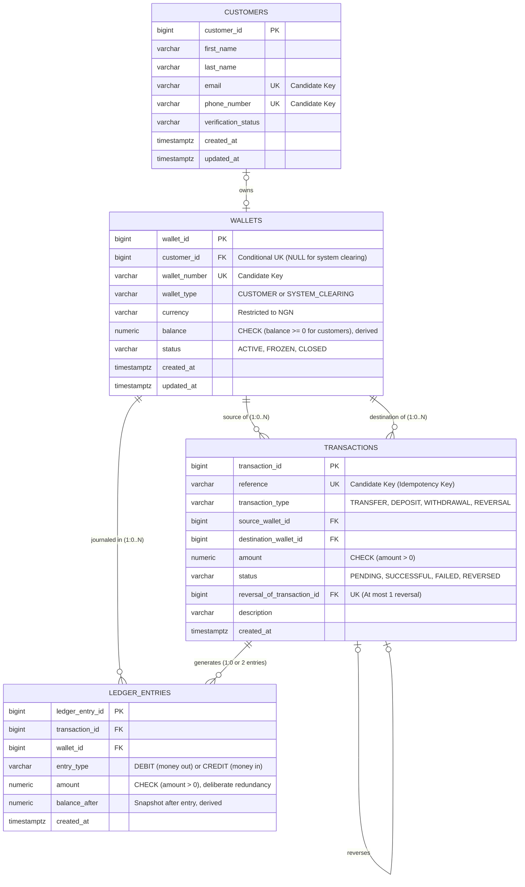

# KoraPay Wallet — Proposed Database Design

**Course:** MIT 8103 Advanced Database Systems  
**Portfolio Milestone:** 1 — Database Design and Modelling  
**Case Study Reference:** [case-study.md](./case-study.md)  
**Status:** Design Proposal (No SQL execution or table creation yet; all implementation features labelled as proposed)

---

## 1. Introduction and Design Objectives

This document presents the relational database design for **KoraPay Wallet**, a simulated Nigerian digital wallet platform engineered for academic study. 

The primary goals of this proposed database design are:
1. **Financial Integrity:** Enforce exact money tracking using an append-only double-entry ledger. In this project, **`DEBIT` represents money leaving a wallet (money out)** and **`CREDIT` represents money entering a wallet (money in)** as an explicit wallet-holder convention adopted for intuitive portfolio modeling (rather than a universal institutional accounting definition).
2. **Concurrency Safety:** Prevent overspending and lost updates caused by stale balance reads during simultaneous transaction requests.
3. **Atomicity:** Guarantee that debiting the sender, crediting the recipient, and recording paired ledger entries succeed together or roll back completely.
4. **Duplicate Prevention (Idempotency):** Ensure that repeated client network requests reusing the same request reference cannot trigger duplicate fund transfers.
5. **Auditability:** Retain an immutable history of all transactions and balance changes through controlled posting logic.

To maintain an optimal balance between academic rigor and practical clarity, the design centers on four core relational tables and incorporates a dedicated **System Clearing Wallet** to handle simulated deposits and withdrawals.

---

## 2. Core Tables and Their Purpose

The proposed database schema consists of four core tables:

| Table Name | Purpose |
| :--- | :--- |
| **`customers`** | Stores customer identity, contact information, and simulated KYC verification status. |
| **`wallets`** | Stores digital wallets denominated in Nigerian Naira (`NGN`), including individual customer wallets and a single system clearing wallet. Stores real-time operational status and a deliberately cached balance. |
| **`transactions`** | Records business-level transaction requests (transfers, deposits, withdrawals, reversals), client idempotency keys, execution statuses, and reversal linkages. |
| **`ledger_entries`** | The immutable financial journal. Records paired debit and credit entries for successful transactions, including a point-in-time balance snapshot (`balance_after`), serving as the single source of financial truth. |

---

## 3. Schema Specification: Tables, Columns, and Data Types

All table and column names follow PostgreSQL conventions (`snake_case`). All monetary attributes strictly use `NUMERIC(18,2)` to prevent floating-point rounding errors.

### 3.1 Table: `customers`
Stores individual and small-business customer profiles.

| Column Name | PostgreSQL Data Type | Constraints | Description |
| :--- | :--- | :--- | :--- |
| `customer_id` | `BIGSERIAL` | `PRIMARY KEY` | Unique surrogate identifier for each customer. |
| `first_name` | `VARCHAR(50)` | `NOT NULL` | Customer's first name. |
| `last_name` | `VARCHAR(50)` | `NOT NULL` | Customer's last name or registered business name. |
| `email` | `VARCHAR(255)` | `NOT NULL, UNIQUE` | Customer's email address (Candidate Key for identity and notifications). |
| `phone_number` | `VARCHAR(20)` | `NOT NULL, UNIQUE` | Unique phone number in standard format (Candidate Key). |
| `verification_status` | `VARCHAR(20)` | `NOT NULL, DEFAULT 'PENDING'` | Simulated KYC status: `'PENDING'`, `'VERIFIED'`, `'SUSPENDED'`. |
| `created_at` | `TIMESTAMPTZ` | `NOT NULL, DEFAULT CURRENT_TIMESTAMP` | Timestamp when the customer profile was created. |
| `updated_at` | `TIMESTAMPTZ` | `NOT NULL, DEFAULT CURRENT_TIMESTAMP` | Timestamp when the customer profile was last modified. |

*Candidate Keys:* `{customer_id}` (Surrogate Primary Key), `{email}` (Alternate Key), `{phone_number}` (Alternate Key).

---

### 3.2 Table: `wallets`
Stores digital wallets denominated in Nigerian Naira (`NGN`). Each customer wallet belongs to exactly one customer, while a single system clearing wallet has no customer owner and serves as the counterparty for simulated deposits and withdrawals.

| Column Name | PostgreSQL Data Type | Constraints | Description |
| :--- | :--- | :--- | :--- |
| `wallet_id` | `BIGSERIAL` | `PRIMARY KEY` | Unique surrogate identifier for each wallet. |
| `customer_id` | `BIGINT` | `NULL, UNIQUE, REFERENCES customers(customer_id)` | Foreign key to customer. Nullable for system clearing wallet; required for customer wallets. Conditional unique identifier for customer wallets. |
| `wallet_number` | `VARCHAR(20)` | `NOT NULL, UNIQUE` | Public wallet identifier (e.g., 10-digit NUBAN-style account number; Candidate Key). |
| `wallet_type` | `VARCHAR(20)` | `NOT NULL, DEFAULT 'CUSTOMER'` | Category: `'CUSTOMER'` or `'SYSTEM_CLEARING'`. |
| `currency` | `VARCHAR(3)` | `NOT NULL, DEFAULT 'NGN'` | ISO currency code. Restricted strictly to `'NGN'`. |
| `balance` | `NUMERIC(18,2)` | `NOT NULL, DEFAULT 0.00` | Current available balance. A **deliberately stored derived value** cached for $O(1)$ constant-time balance lookups. |
| `status` | `VARCHAR(20)` | `NOT NULL, DEFAULT 'ACTIVE'` | Operational status: `'ACTIVE'`, `'FROZEN'`, or `'CLOSED'`. |
| `created_at` | `TIMESTAMPTZ` | `NOT NULL, DEFAULT CURRENT_TIMESTAMP` | Timestamp when the wallet was opened. |
| `updated_at` | `TIMESTAMPTZ` | `NOT NULL, DEFAULT CURRENT_TIMESTAMP` | Timestamp when balance or status was last modified. |

*Candidate Keys for `wallets`:* `{wallet_id}` (Surrogate Primary Key), `{wallet_number}` (Alternate Key).  
*Note on `customer_id`:* Because `customer_id` is nullable (the system clearing wallet has no owner), it cannot serve as a candidate key for the entire `wallets` relation under formal relational definitions. It functions as a **conditional unique identifier** for customer wallets.

*Proposed Integrity Constraints on `wallets`:*
- **Single Wallet per Customer:** `UNIQUE (customer_id)` ensures that a customer can own at most one wallet.
- **Customer vs. System Ownership Rule:** A proposed check constraint enforces that customer wallets must have a non-null `customer_id`, while system clearing wallets must have no owner:
  ```sql
  CHECK (
      (wallet_type = 'CUSTOMER' AND customer_id IS NOT NULL) OR
      (wallet_type = 'SYSTEM_CLEARING' AND customer_id IS NULL)
  )
  ```
- **Single System Clearing Wallet Rule:** To guarantee that only one system clearing wallet exists across the entire platform, a proposed partial unique index is specified:
  ```sql
  CREATE UNIQUE INDEX uq_single_system_clearing_wallet 
  ON wallets (wallet_type) 
  WHERE wallet_type = 'SYSTEM_CLEARING';
  ```
- **Non-Negative Balance Rule:** Customer wallets cannot have negative balances; the system clearing account may hold negative balances to reflect net funds injected into the simulated wallet ecosystem:
  ```sql
  CHECK (
      (wallet_type = 'CUSTOMER' AND balance >= 0) OR 
      (wallet_type = 'SYSTEM_CLEARING')
  )
  ```

---

### 3.3 Table: `transactions`
Acts as the transaction receipt, intent log, and idempotency record. Captures participating wallets, request reference, lifecycle status, and reversal relationships.

| Column Name | PostgreSQL Data Type | Constraints | Description |
| :--- | :--- | :--- | :--- |
| `transaction_id` | `BIGSERIAL` | `PRIMARY KEY` | Unique surrogate identifier for each transaction. |
| `reference` | `VARCHAR(64)` | `NOT NULL, UNIQUE` | Unique client-supplied request reference (Idempotency Key; Candidate Key). |
| `transaction_type` | `VARCHAR(20)` | `NOT NULL` | Movement type: `'TRANSFER'`, `'DEPOSIT'`, `'WITHDRAWAL'`, `'REVERSAL'`. |
| `source_wallet_id` | `BIGINT` | `NOT NULL, REFERENCES wallets(wallet_id)` | Debited wallet. For deposits, this is the System Clearing Wallet. |
| `destination_wallet_id` | `BIGINT` | `NOT NULL, REFERENCES wallets(wallet_id)` | Credited wallet. For withdrawals, this is the System Clearing Wallet. |
| `amount` | `NUMERIC(18,2)` | `NOT NULL` | Transaction amount. Must satisfy `CHECK (amount > 0)`. |
| `status` | `VARCHAR(20)` | `NOT NULL, DEFAULT 'PENDING'` | State: `'PENDING'`, `'SUCCESSFUL'`, `'FAILED'`, `'REVERSED'`. |
| `reversal_of_transaction_id` | `BIGINT` | `NULL, REFERENCES transactions(transaction_id)` | Self-referencing foreign key linking a reversal to the original transaction. |
| `description` | `VARCHAR(255)` | `NULL` | Optional memo, narration, or system failure reason. |
| `created_at` | `TIMESTAMPTZ` | `NOT NULL, DEFAULT CURRENT_TIMESTAMP` | Timestamp when the request was initiated. |

*Candidate Keys:* `{transaction_id}` (Surrogate Primary Key), `{reference}` (Alternate Key).

*Proposed Integrity Constraints on `transactions`:*
- **Distinct Wallets:** `CHECK (source_wallet_id <> destination_wallet_id)`.
- **Positive Amount:** `CHECK (amount > 0)`.
- **Single Full Reversal Rule:** A transaction may be reversed at most once. This is enforced via a proposed partial unique index:
  ```sql
  CREATE UNIQUE INDEX uq_single_reversal_per_transaction 
  ON transactions (reversal_of_transaction_id) 
  WHERE reversal_of_transaction_id IS NOT NULL;
  ```

*Lifecycle and Failure Policy Note:* When a transaction fails validation during processing (e.g., due to insufficient funds or frozen status) and the transaction is aborted via `ROLLBACK`, the initial `'PENDING'` record is completely removed by PostgreSQL's rollback. A persistent `'FAILED'` receipt row is not retained in the database unless an explicit separate failure-recording policy is proposed (e.g., executing an independent transaction to write the failure log).

---

### 3.4 Table: `ledger_entries`
The immutable, double-entry financial journal. Balance changes are never applied directly to wallets without writing matching, balanced journal entries here.

| Column Name | PostgreSQL Data Type | Constraints | Description |
| :--- | :--- | :--- | :--- |
| `ledger_entry_id` | `BIGSERIAL` | `PRIMARY KEY` | Unique surrogate identifier for each journal line. |
| `transaction_id` | `BIGINT` | `NOT NULL, REFERENCES transactions(transaction_id)` | Parent transaction foreign key. |
| `wallet_id` | `BIGINT` | `NOT NULL, REFERENCES wallets(wallet_id)` | Affected wallet foreign key. |
| `entry_type` | `VARCHAR(6)` | `NOT NULL` | Project convention: `'DEBIT'` (money out) or `'CREDIT'` (money in). |
| `amount` | `NUMERIC(18,2)` | `NOT NULL` | Movement amount. Must satisfy `CHECK (amount > 0)`. |
| `balance_after` | `NUMERIC(18,2)` | `NOT NULL` | Point-in-time snapshot of `wallets.balance` immediately after this entry was applied (**deliberately stored derived value**). |
| `created_at` | `TIMESTAMPTZ` | `NOT NULL, DEFAULT CURRENT_TIMESTAMP` | Immutable timestamp when this record was written. |

*Candidate Keys:* `{ledger_entry_id}` (Surrogate Primary Key).

*Deliberate Redundancy & Normalisation Note:* In `ledger_entries`, `transaction_id` functionally determines `amount` (`transaction_id -> amount`) because both balanced entries for a transaction must share the transaction's monetary value. Because `transaction_id` is not a superkey in `ledger_entries`, this represents a deliberate redundancy rather than a strictly pure 3NF design. As detailed in [Section 8](#8-financial-consistency-controlled-posting-and-permissions), this redundancy is strictly validated by **controlled posting logic and database permissions** rather than relying on schema structure alone.

---

## 4. Entity-Relationship (ER) Diagram

The diagram below models the four core tables, their structural cardinalities, attributes, keys, and operational constraints:



---

## 5. Relationships and Cardinalities Explained

1. **`customers` to `wallets` (`CUSTOMERS o|--o| WALLETS : owns` / Optional Zero-or-One to Zero-or-One):**
   - The ownership relationship is modeled as optional zero-or-one on both ends (`0..1` to `0..1`):
     - Every **customer wallet** requires exactly one customer owner (`customer_id IS NOT NULL`).
     - The **system clearing wallet** has no customer owner (`customer_id IS NULL`).
     - A customer may be associated with at most one wallet (`UNIQUE (customer_id)`).
   - **Atomic Registration Flow:** In operational practice, application registration provisions the customer profile and their initial NGN wallet together within **one single atomic registration transaction** (`BEGIN; INSERT INTO customers ...; INSERT INTO wallets ...; COMMIT;`), ensuring a customer is never left without an active wallet upon successful onboarding.

2. **`wallets` to `transactions` (One-to-Many / `1:0..N`):**
   - A wallet can be referenced as the `source_wallet_id` across zero or more transaction requests.
   - A wallet can be referenced as the `destination_wallet_id` across zero or more transaction requests.

3. **`transactions` to `ledger_entries` (One-to-Zero-or-Two / `1:0 or 2 entries`):**
   - **Pending or Failed Transactions:** Write **zero** ledger entries (`0`). Because no money has moved, no debit or credit is journaled.
   - **Successful Transactions:** Generate **exactly two balanced ledger entries** (`2`):
     - For a transfer: 1 DEBIT (money out) on the sender's wallet, 1 CREDIT (money in) on the recipient's wallet of equal amount.
     - For a deposit: 1 DEBIT on the System Clearing Wallet, 1 CREDIT on the customer's wallet.
     - For a withdrawal: 1 DEBIT on the customer's wallet, 1 CREDIT on the System Clearing Wallet.
   - **Reversals and Retention of Original Entries:** When an original transaction is marked `'REVERSED'`, it **retains its two original ledger entries** intact. A successful reversal transaction creates **two new compensating ledger entries** (1 DEBIT on original recipient, 1 CREDIT on original sender), bringing the total to four immutable ledger entries across the original and reversal transactions.

4. **`wallets` to `ledger_entries` (One-to-Many / `1:0..N`):**
   - Over time, each wallet accumulates an immutable audit trail of debit and credit rows corresponding to every completed transaction it participated in.

5. **`transactions` to `transactions` (Self-Referencing Optional Zero-or-One / `TRANSACTIONS o|--o| TRANSACTIONS : reverses`):**
   - Both ends of the reversal relationship are optional zero-or-one (`0..1` to `0..1`):
     - A normal transaction is not a reversal, so it references no original transaction (`reversal_of_transaction_id IS NULL`).
     - A transaction may or may not be reversed; if reversed, at most one reversal transaction can reference it.
   - Enforced by a proposed partial unique index on `reversal_of_transaction_id` (`WHERE reversal_of_transaction_id IS NOT NULL`).

---

## 6. Business Rules and Database Constraints Matrix

The table below maps each business rule from [case-study.md](./case-study.md) directly to its proposed database-level enforcement mechanism:

| Case Study Business Rule | Proposed Enforcement Mechanism | Enforcement Layer |
| :--- | :--- | :--- |
| **"Each customer has one NGN wallet."** | `wallets.customer_id UNIQUE` constraint permits at most one wallet. Single registration transaction provisions both records atomically. `wallets.currency CHECK (currency = 'NGN')` restricts currency. | Static Database Constraint & Transaction Logic |
| **"System clearing wallet has no owner; only one system clearing wallet exists."** | `CHECK ((wallet_type = 'CUSTOMER' AND customer_id IS NOT NULL) OR (wallet_type = 'SYSTEM_CLEARING' AND customer_id IS NULL))` combined with partial unique index `CREATE UNIQUE INDEX uq_single_system_clearing_wallet ON wallets (wallet_type) WHERE wallet_type = 'SYSTEM_CLEARING'`. | Static Database Constraint & Partial Unique Index |
| **"Transaction amounts must be greater than zero."** | `CHECK (amount > 0)` on both `transactions` and `ledger_entries`. | Static Database Constraint |
| **"Customer wallet balances must not become negative."** | `CHECK ((wallet_type = 'CUSTOMER' AND balance >= 0) OR wallet_type = 'SYSTEM_CLEARING')` on `wallets`. | Static Database Constraint |
| **"A customer cannot transfer money to the same wallet."** | `CHECK (source_wallet_id <> destination_wallet_id)` on `transactions`. | Static Database Constraint |
| **"Each transaction request has a unique reference."** | `UNIQUE (reference)` on `transactions`. Enforces idempotency at the database storage engine layer. | Static Database Constraint |
| **"At most one full reversal per original transaction."** | Partial unique index `CREATE UNIQUE INDEX uq_single_reversal_per_transaction ON transactions (reversal_of_transaction_id) WHERE reversal_of_transaction_id IS NOT NULL`. | Partial Unique Index |
| **"Pending/failed transactions write zero ledger entries; successful write two."** | Enforced by controlled posting logic within a single transaction. Foreign keys link records, but posting service guarantees paired entries. | Controlled Posting Logic |
| **"Reversals preserve original records and post compensating entries."** | Reversal logic validates original was successful, swaps source/destination, posts two new compensating entries, updates original status to `'REVERSED'`, preserving original ledger entries. | Controlled Posting Logic |
| **"Ledger entries are immutable; wallet balances match ledger sums."** | Direct `INSERT`, `UPDATE`, and `DELETE` on `ledger_entries` revoked from application users. Modifications pass strictly through trusted posting routines. | Database Role Permissions & Controlled Posting Logic |

---

## 7. Transaction Logic and Concurrency Boundaries (ACID)

While table constraints provide declarative guardrails, multi-table operations, race condition prevention, and failure handling require **database transactions (`BEGIN ... COMMIT / ROLLBACK`)** with explicit locking strategies.

### 7.1 Concurrency Hazard: Lost Updates and Overspending from Stale Balance Reads
- **The True Concurrency Hazard:** Under PostgreSQL's default `READ COMMITTED` transaction isolation level, dirty reads are mathematically impossible. The real concurrency danger in wallet systems is **lost updates** or **overspending (double-spending) caused by stale balance reads**:
  - Suppose Customer A has a balance of ₦10,000.
  - Two transfer requests (Request 1 for ₦8,000 and Request 2 for ₦8,000) arrive concurrently on separate database connections.
  - Both transactions read the current balance as ₦10,000 concurrently. Both application threads determine that ₦10,000 ≥ ₦8,000 and proceed to execute updates.
  - Without row-level locking, both updates succeed or one overwrites the other, leaving the wallet in an illegal state or overdrafting the account to an unauthorized balance.
- **Lock Ordering Strategy to Reduce Wallet-Lock Deadlocks:**
  1. A fund movement transaction begins (`BEGIN`).
  2. To **reduce wallet-lock deadlocks**, the transaction acquires exclusive row-level locks on **BOTH** the source and destination wallets in a deterministic global order: **ascending `wallet_id` order**:
     ```sql
     -- Lock both wallets in strict numeric order to reduce wallet-lock deadlocks
     SELECT wallet_id, balance, status 
     FROM wallets 
     WHERE wallet_id IN ($source_id, $destination_id) 
     ORDER BY wallet_id ASC 
     FOR UPDATE;
     ```
  3. Locking in deterministic ID order ensures that if Transaction 1 transfers from Wallet 1 to Wallet 2 while Transaction 2 concurrently transfers from Wallet 2 to Wallet 1, both transactions attempt to acquire the lock on Wallet 1 first. One transaction obtains the lock while the other waits cleanly, significantly reducing cyclic wait deadlocks between competing wallet transfers.
  4. **Residual Deadlock Risks and Application Retry:** Sorting wallet IDs reduces deadlocks on wallet rows, but other database locks (such as page locks, unique index locks on `transactions.reference`, or foreign key validation locks) can still cause deadlocks. When PostgreSQL detects a deadlock (`40P01: deadlock_detected`), it automatically aborts one of the conflicting transactions. The application must catch this exception and **retry the entire transaction using the exact same request reference (idempotency key)**.
  5. With both rows locked, the transaction validates:
     - Both wallets have `status = 'ACTIVE'`.
     - The source wallet has sufficient funds (`balance >= amount`).
  6. If validation fails, the transaction rolls back cleanly (`ROLLBACK`) without modifying data.

### 7.2 Atomic Fund Movement and Correct Rollback / Error Behaviour
- **Atomicity Requirement:** The sender's debit, the recipient's credit, the transaction record, and the two paired ledger lines must commit together or not at all.
- **PostgreSQL Aborted Transaction Behaviour:**
  - If an individual SQL statement encounters an error inside a PostgreSQL transaction block (such as a constraint violation or syntax error), PostgreSQL places the transaction into an **aborted state** (`current transaction is aborted, commands ignored until end of transaction block`).
  - Subsequent SQL queries within that session are rejected until the client issues an explicit `ROLLBACK`. The application must properly catch database exceptions and send `ROLLBACK` to release connection resources.
- **Rollback of Rejected Requests and Absence of PENDING Records:**
  - If a transaction is rejected during processing (e.g., due to insufficient balance or an inactive wallet) and the transaction issues a `ROLLBACK`, PostgreSQL's rollback discards all changes made in that transaction block, **including the initial `'PENDING'` record in `transactions`**.
  - As a result, no `'PENDING'` or `'FAILED'` receipt row remains in the database from a rolled-back transaction. If the application requires a persistent record of rejected transfer attempts, a separate, autonomous failure-recording policy must be proposed (such as logging to a dedicated audit table or executing a distinct transaction to write a `'FAILED'` status record).
- **Uncertainty on Connection Loss Around COMMIT:**
  - If a network drop or client timeout occurs while calling `COMMIT`, the client cannot know whether the server executed the commit before the disconnection or aborted the transaction.
  - **Resolution:** The client must **not** generate a new transaction request with a new reference. Instead, the client must retry using the **exact same request reference (idempotency key)**. The server checks the existing reference to determine whether the transaction was committed or needs to be executed, ensuring safe recovery.

### 7.3 Idempotency and Duplicate Request Handling
To ensure safe retries:
1. **Claim the Reference First:** Within the transfer transaction, the application attempts to insert the `transactions` record with status `'PENDING'` before moving money.
2. **Handling Unique Conflicts Without an Aborted Transaction:**
   - If an insert triggers a `UNIQUE (reference)` collision, PostgreSQL aborts the entire transaction block, preventing any further queries in that transaction.
   - To handle this gracefully, the application can either:
     - Use `INSERT INTO transactions (...) VALUES (...) ON CONFLICT (reference) DO NOTHING;` to detect existing references without aborting the transaction block, OR
     - Catch the unique constraint violation exception, issue an immediate `ROLLBACK`, and open a new, clean read-only transaction to inspect the existing transaction record.
3. **Payload Verification (Rejecting Mismatched Requests):**
   - When a duplicate reference is detected on a retry, the system queries the existing transaction record and compares the request parameters: `source_wallet_id`, `destination_wallet_id`, `amount`, and `currency`.
   - **If the payload matches:** The original transaction status and receipt are returned to the caller safely without re-debiting.
   - **If the payload does NOT match:** The request is rejected immediately with an error (e.g., `Idempotency Conflict: Parameter Mismatch`) to prevent reference hijacking or accidental parameter alteration.

### 7.4 Proposed Reversal Lifecycle
Reversals undo completed transactions while preserving historical integrity:
1. **Validation:** Validate that the original transaction exists, has `status = 'SUCCESSFUL'`, and has `transaction_type IN ('TRANSFER', 'DEPOSIT', 'WITHDRAWAL')` (reversals of reversals are rejected).
2. **Single Reversal Check:** Verify that no reversal has already been executed for this transaction (`reversal_of_transaction_id` unique constraint check).
3. **Swap Wallets and Exact Amount:** The reversal swaps the original wallets (the original recipient is debited; the original sender is credited) using the **exact original amount** (full reversals only).
4. **Locking & Solvency Check:** Both wallets are locked in `wallet_id` order. The system checks that the wallet to be debited (original recipient) is `ACTIVE` and has sufficient balance (`balance >= amount`).
5. **Preserve Original Records & Append Compensating Entries:** Original ledger entries and original transaction rows are **never modified or deleted**. The original transaction retains its two original ledger entries. A new transaction row is inserted (`transaction_type = 'REVERSAL'`), and **two new compensating ledger entries** are written:
   - 1 DEBIT on the original recipient's wallet.
   - 1 CREDIT on the original sender's wallet.
6. **Update Original Transaction Status:** The original transaction status is updated to `'REVERSED'`.

---

## 8. Financial Consistency: Controlled Posting and Permissions

In KoraPay Wallet, balance tracking involves two distinct representations:
1. **Cached Balance (`wallets.balance`):** A **deliberately stored derived value** maintained directly on the wallet record for $O(1)$ constant-time balance lookups during payments.
2. **True Audit Balance (`ledger_entries`):** The immutable, append-only history of every debit and credit entry that has ever occurred.

### Why Foreign Keys Alone Cannot Enforce Financial Integrity
Foreign key constraints guarantee referential integrity (ensuring linked IDs exist), but they cannot:
- Enforce that a transaction writes exactly two ledger entries.
- Ensure that one entry is a DEBIT and the other is a CREDIT.
- Guarantee that the debit amount equals the credit amount.
- Ensure that `wallets.balance` equals the net sum of historical ledger entries.

### Proposed Solution: Controlled Posting Service and Strict Database Permissions
To guarantee financial integrity at the database layer:
1. **Encapsulated Posting Routine:** All balance updates and ledger writes must pass exclusively through a dedicated, controlled posting routine (e.g., a proposed PostgreSQL PL/pgSQL stored procedure `post_ledger_movement(...)` or internal posting service). This routine:
   - Locks both wallets in `wallet_id` order.
   - Validates wallet statuses and available balances.
   - Updates `wallets.balance` for both wallets atomically.
   - Inserts exactly two balanced rows into `ledger_entries` with matching amounts and point-in-time `balance_after` snapshots.
   - Sets the transaction status to `'SUCCESSFUL'`.
2. **Principle of Least Privilege (Database Permissions):**
   - Application database users are granted `SELECT` privileges to read wallet balances and transaction histories.
   - Direct `INSERT`, `UPDATE`, and `DELETE` privileges on `ledger_entries` are **strictly revoked** from application database roles.
   - Direct `UPDATE` on `wallets.balance` is **strictly revoked** from application database roles.
   - Writes to `ledger_entries` and updates to `wallets.balance` can only be performed by executing the trusted posting function (using `SECURITY DEFINER`), creating an append-only, tamper-resistant financial ledger.
3. **Automated Balance-to-Ledger Reconciliation Query:**
   The database integrity can be audited at any time using a reconciliation query that compares cached balances against ledger sums:
   ```sql
   -- Proposed Balance Reconciliation Audit Query
   SELECT 
       w.wallet_id,
       w.wallet_number,
       w.balance AS cached_balance,
       COALESCE(SUM(
           CASE 
               WHEN le.entry_type = 'CREDIT' THEN le.amount 
               WHEN le.entry_type = 'DEBIT'  THEN -le.amount 
               ELSE 0 
           END
       ), 0.00) AS ledger_sum,
       w.balance - COALESCE(SUM(
           CASE 
               WHEN le.entry_type = 'CREDIT' THEN le.amount 
               WHEN le.entry_type = 'DEBIT'  THEN -le.amount 
               ELSE 0 
           END
       ), 0.00) AS discrepancy
   FROM wallets w
   LEFT JOIN ledger_entries le ON w.wallet_id = le.wallet_id
   GROUP BY w.wallet_id, w.wallet_number, w.balance
   HAVING w.balance <> COALESCE(SUM(
       CASE 
           WHEN le.entry_type = 'CREDIT' THEN le.amount 
           WHEN le.entry_type = 'DEBIT'  THEN -le.amount 
           ELSE 0 
       END
   ), 0.00);
   ```

---

## 9. Duplicate Request Prevention (Idempotency)

When mobile apps or web clients experience fluctuating network conditions, a user may tap "Transfer" multiple times, or client network libraries may automatically retry timed-out requests.

### Proposed Idempotency Protocol:
1. **Client Generates Key:** For every distinct transfer attempt, the client generates a unique idempotency key (UUID v4) and passes it in the `reference` field.
2. **Claiming the Reference Within the Transaction:** The system attempts to register the `reference` in `transactions` with `status = 'PENDING'` as the very first step of the transfer transaction.
3. **Handling Duplicate Reference Submissions:**
   - If a request arrives with an existing `reference`, the unique constraint (`UNIQUE (reference)`) triggers.
   - The application catches this without executing queries inside an aborted transaction block (using `ON CONFLICT DO NOTHING` or issuing a clean lookup query after rollback).
   - The system retrieves the existing transaction record:
     - **Payload Comparison:** The system compares `source_wallet_id`, `destination_wallet_id`, `amount`, and `currency`.
     - **If Payload Matches:** The system returns the current receipt and status (`SUCCESSFUL`, `PENDING`, or `FAILED` if separately recorded) of the existing transaction. No funds are re-debited.
     - **If Payload Mismatches:** The request is rejected immediately with an error (e.g., `422 Unprocessable Entity - Idempotency Key Reused with Different Payload`).

---

## 10. Database Normalisation (Assessing All Candidate Keys)

Formal normalisation analysis requires evaluating dependencies against **all candidate keys**, not merely an arbitrarily chosen surrogate primary key.

### Formal Definition of Candidate Keys Across Core Tables:
A candidate key must be a minimal superkey containing only non-null values that uniquely identifies every tuple in the relation:
- **`customers`:**
  - Candidate Key 1: `{customer_id}` (Surrogate Primary Key)
  - Candidate Key 2: `{email}` (Alternate Key)
  - Candidate Key 3: `{phone_number}` (Alternate Key)
- **`wallets`:**
  - Candidate Key 1: `{wallet_id}` (Surrogate Primary Key)
  - Candidate Key 2: `{wallet_number}` (Alternate Key)
  - *Status of `customer_id`:* Nullable `customer_id` is a **conditional unique identifier** for customer wallets. Because candidate keys cannot contain null values, it is not a candidate key for the entire `wallets` table.
- **`transactions`:**
  - Candidate Key 1: `{transaction_id}` (Surrogate Primary Key)
  - Candidate Key 2: `{reference}` (Alternate Key / Idempotency Key)
- **`ledger_entries`:**
  - Candidate Key 1: `{ledger_entry_id}` (Surrogate Primary Key)

---

### 10.1 First Normal Form (1NF)
**Formal Requirements:**
- Each attribute must contain only atomic values relative to the relational domain (no repeating groups, arrays, or nested relations).
- Each record must be uniquely identifiable by a primary key.

**Application in KoraPay Wallet:**
- **Atomicity:** All attributes contain single scalar values. Repeating ledger lines are not stored as JSON blobs or delimited arrays inside `transactions`; they are modeled as discrete, atomic rows in `ledger_entries`.
- **Note on Name Separation:** While splitting customer names into `first_name` and `last_name` is an application design choice that facilitates sorting, indexing, and display formatting, it is **not** a formal requirement of 1NF. In relational theory, a full name string is an atomic scalar value.
- **Uniqueness:** Every relation has an explicit primary key and unique constraints establishing row identity.

---

### 10.2 Second Normal Form (2NF)
**Formal Requirements:**
- The relation must be in 1NF.
- Every non-prime attribute (attributes not part of any candidate key) must be fully functionally dependent on **every candidate key** (no partial functional dependencies on a proper subset of a composite candidate key).

**Application in KoraPay Wallet:**
- Across all four tables, **all candidate keys are single attributes** (e.g., `{customer_id}`, `{email}`, `{phone_number}`, `{wallet_id}`, `{wallet_number}`, `{reference}`).
- Because there are no composite candidate keys anywhere in the schema, a partial dependency on a subset of a candidate key is mathematically impossible. Therefore, every table is in 2NF.

---

### 10.3 Third Normal Form (3NF) and Deliberate Redundancy
**Formal Rule of 3NF:**
A relation is in Third Normal Form (3NF) if it is in 2NF and, for every non-trivial functional dependency $X \rightarrow A$, either:
1. $X$ is a superkey, or
2. $A$ is a prime attribute (part of a candidate key).

**Evaluation and Nuance in KoraPay Wallet:**
- **Customer-to-Wallet Entity Separation:**
  - Storing customer attributes in `wallets` is sometimes mistakenly described as a 3NF transitive dependency violation (`wallet_id -> customer_id -> customer_email`). However, because customer wallets have a 1-to-1 correspondence with customers, `customer_id` and `wallet_id` functionally determine each other for customer wallets.
  - The true justification for separating `customers` and `wallets` is:
    1. **Entity Decoupling:** Customers represent natural persons or legal business entities with identity attributes; wallets represent financial ledger accounts.
    2. **Handling the System Clearing Wallet:** Merging customers and wallets would force the system clearing wallet (`wallet_type = 'SYSTEM_CLEARING'`) to store dummy customer data or violate `NOT NULL` constraints on personal identity attributes (`first_name`, `last_name`, `email`, `phone_number`).
    3. **Schema Extensibility:** Normalising wallets into a separate table allows future evolution (such as multi-currency wallets per customer) without altering table architecture.
- **Acknowledged Deliberate Redundancy in `ledger_entries`:**
  - In `ledger_entries`, `transaction_id` determines `amount` (`transaction_id -> amount`) because both entries generated for a transaction must share the transaction's monetary value.
  - Here, `{transaction_id}` is **not** a superkey in `ledger_entries` (since each transaction generates up to two ledger entries), and `amount` is **not** a prime attribute.
  - Therefore, this design intentionally departs from strict 3NF by storing `amount` redundantly on each ledger line. This deliberate denormalisation ensures that each ledger entry is self-contained for accounting and audit calculations without requiring a join to `transactions`. This redundancy is strictly verified by controlled posting logic rather than schema normalization alone.

---

### 10.4 Identification of Deliberately Stored Derived Values (Controlled Denormalisation)
Strict normalisation theory discourages storing values that can be derived from other stored facts. In this schema, two attributes are **deliberately stored derived values**:
1. **`wallets.balance`:** Represents the net sum of all historical credits minus debits for that wallet.
2. **`ledger_entries.balance_after`:** Represents a point-in-time snapshot of the wallet balance immediately following that specific entry.

**Engineering Justification:**
In high-throughput financial systems, recalculating wallet balances by scanning and summing millions of historical ledger records on every payment would introduce unacceptable latency and database contention. Storing `wallets.balance` enables constant-time $O(1)$ balance lookups and pessimistic row locking during transfers without scanning historical ledger rows. Storing `balance_after` provides an immutable, instantaneous verification snapshot for audit trails. As explained in [Section 8](#8-financial-consistency-controlled-posting-and-permissions), strict controlled posting logic guarantees that these derived values remain in perfect synchronization with the ledger.

---

## 11. Simple English Glossary of Unfamiliar Terms

- **ACID:** Four guarantees provided by relational database transactions:
  - **Atomicity:** All operations within a transaction succeed together, or everything rolls back (all-or-nothing).
  - **Consistency:** Transactions transition data only between valid states conforming to all constraints.
  - **Isolation:** Concurrent transactions execute without interfering with one another.
  - **Durability:** Committed changes persist permanently, even through system crashes.
- **Aborted Transaction State:** A PostgreSQL mechanism where any error inside a transaction block causes the entire transaction to reject subsequent queries until an explicit `ROLLBACK` is issued.
- **Candidate Key:** An attribute or minimal set of non-null attributes that uniquely identifies a record in a table. A table may have multiple candidate keys (e.g., `customer_id`, `email`, `phone_number`); one is designated as the primary key while others serve as alternate unique keys.
- **Compensating Entry:** A new ledger entry created to offset or reverse a prior transaction without altering or deleting the original historical record.
- **Conditional Unique Identifier:** An attribute that enforces uniqueness when present (e.g., `customer_id` for customer wallets) but contains nulls for special records (e.g., system clearing wallet), disqualifying it as a formal candidate key for the entire relation.
- **Controlled Posting Logic:** Hardened database procedures or backend routines that encapsulate balance checks, wallet updates, and paired ledger writes inside a single transaction, preventing direct, unvalidated edits.
- **DEBIT and CREDIT (Wallet Convention):** In this project, **DEBIT denotes money leaving a wallet (money out)** and **CREDIT denotes money entering a wallet (money in)**. This is a wallet-holder convention adopted for portfolio modeling, contrasting with traditional institutional accounting where debits and credits vary depending on asset and liability classifications.
- **Idempotency:** A property whereby executing an operation multiple times produces the exact same result as executing it once, preventing duplicate charges when network retries occur.
- **Lost Update:** A concurrency hazard where two transactions read the same data simultaneously and overwrite each other's changes, leading to lost data or unauthorized overdrafts.
- **Pessimistic Locking (`SELECT ... FOR UPDATE`):** Instructing the database engine to lock selected rows until the current transaction completes, forcing competing transactions to wait and preventing race conditions.
- **Reducing Wallet-Lock Deadlocks:** A lock ordering strategy that sorts wallet IDs before acquiring locks to prevent cyclic waits between wallet transfers, though application retries remain necessary for residual deadlocks on other database locks.
- **Single System Clearing Wallet:** A special platform-level account with no customer owner (`customer_id = NULL`) that acts as the counterparty for simulated cash deposits and withdrawals, ensuring double-entry balance across all transactions.
- **Surrogate Key:** An artificially generated identifier (e.g., auto-incrementing integer or UUID) used as a primary key, independent of real-world business attributes.
